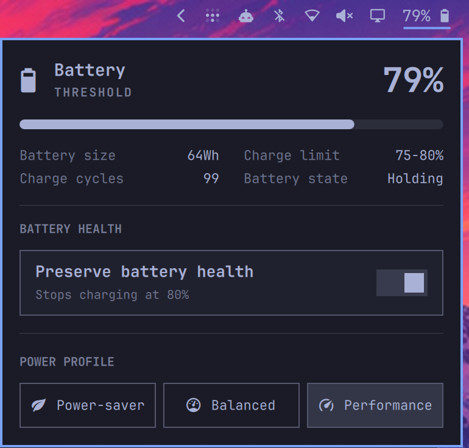

# Battery Health for Omarchy

The built-in Omarchy power widget, extended with a battery-health toggle that
uses the charging policy exposed by your laptop through UPower.



## What it does

- Shows battery level, capacity, charge cycles, charge rate, and remaining time.
- Switches between the power profiles available on the system.
- Enables or disables the laptop's firmware-provided charge limit.
- Hides the battery-health control when the hardware does not support it.
- Shows the battery percentage in the bar when you right-click the battery icon.

The plugin does not hard-code an ASUS path or force an 80% threshold. UPower
reports the policy supported by the laptop, which may be a fixed limit, a
start/end range, or a firmware-optimized charging mode.

## Installing it

```bash
omarchy plugin add https://github.com/patcastle/omarchy-battery-health --enable
```

The plugin declares itself as a clone of `omarchy.power`, so Omarchy replaces
the built-in power widget in place and keeps its bar position and settings. You
do not need to disable or move the original widget manually.

Click the battery icon and use **Preserve battery health**. The control only
appears when UPower reports charge-threshold support.

## Compatibility

Requires an Omarchy version with shell plugin support, plus `upower` and
`busctl`. Those are part of a normal Omarchy installation.

Actual support depends on the laptop firmware, kernel driver, and UPower. The
plugin talks only to UPower's vendor-neutral D-Bus API; it contains no
manufacturer-specific code and does not use `sudo` or `pkexec`.

If another tool already manages your charge threshold, use one or the other so
they do not fight over the setting.

## Removing it

```bash
omarchy plugin disable patcastle.power
omarchy plugin remove patcastle.power
```

Disabling or removing it restores the built-in `omarchy.power` widget.

## Development

```bash
omarchy plugin validate .
./test.sh
```

This is a clone of Omarchy's power widget while the corresponding upstream
change is under review in [basecamp/omarchy#8579](https://github.com/basecamp/omarchy/pull/8579).

## License

MIT
