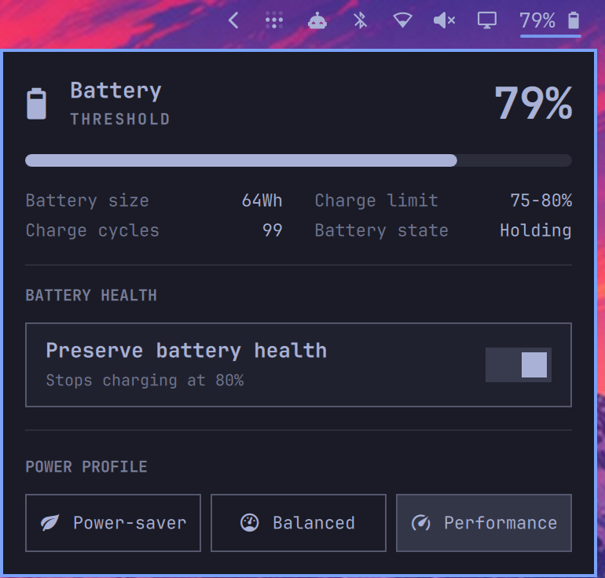

# Battery Health for Omarchy

The built-in Omarchy power widget, extended with a battery-health toggle that
uses the charging policy exposed by your laptop through UPower.


_Wallpaper by [Simon Høiberg](https://x.com/SimonHoiberg), featuring Switzerland, our home._

## What it does

- Shows battery level, capacity, charge cycles, charge rate, and remaining time.
- Switches between the power profiles available on the system.
- Enables or disables the laptop's firmware-provided charge limit.
- Hides the battery-health control when the hardware does not support it.
- Shows the battery percentage in the bar when you right-click the battery icon.

UPower reports the charging policy supported by the laptop. This may be a fixed
limit, a start/end range, or a firmware-optimized charging mode.

## Panel close-up



## Installing it

```bash
omarchy plugin add https://github.com/patcastle/omarchy-battery-health --enable
```

The plugin declares itself as a clone of `omarchy.power`, so Omarchy replaces
the built-in power widget in place and keeps its bar position and settings. You
do not need to disable or move the original widget manually.

Click the battery icon and use **Preserve battery health**. The plugin hides
the control when UPower confirms that the hardware does not support charge limits.

If a status query fails, the plugin shows “Battery protection status unavailable”
and disables the toggle. It labels any previous state as the last known state.
The plugin retries every five seconds while the panel is open and restores the
control after a successful query.

## Compatibility

Requires an Omarchy version with shell plugin support, plus `upower` and
`busctl`. Those are part of a normal Omarchy installation.

Actual support depends on the laptop firmware, kernel driver, and UPower. The
plugin uses UPower's D-Bus API and does not use `sudo` or `pkexec`.

If another tool already manages your charge threshold, use one or the other so
they do not fight over the setting.

## Removing it

```bash
omarchy plugin disable patcastle.power
omarchy plugin remove patcastle.power
```

Disabling or removing it restores the built-in `omarchy.power` widget.

## Development

```bash
omarchy plugin validate .
./test.sh
```

For VS Code Auto Attach or a JavaScript Debug Terminal, run the tests in one
process to avoid Node's inspector startup error:

```bash
./test.sh --test-isolation=none
```

This option requires Node 23.6 or later and keeps debugging available.
Without this option, each test file runs in a separate process.

To debug in VS Code, open this repository as the workspace folder.
Set a breakpoint in `Model.js` or a JavaScript test, then select **Debug all tests**
in Run and Debug and press **F5**.
To run one test file, open that file and select **Debug current test file**.
These configurations debug JavaScript tests and model functions.
The popup runs separately in Quickshell, and the charge helper runs in Bash.

This is a clone of Omarchy's power widget while the corresponding upstream
change is under review in [basecamp/omarchy#8579](https://github.com/basecamp/omarchy/pull/8579).

## License

MIT
